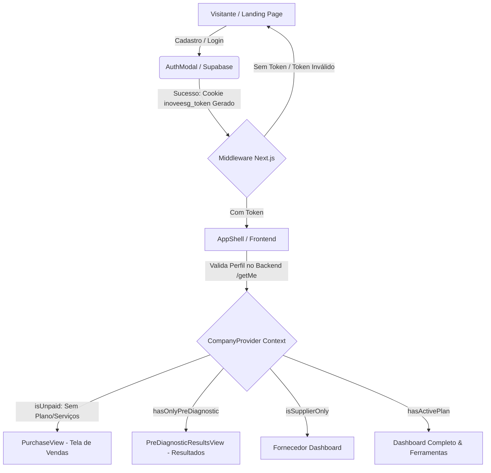

# Documentação Técnica: Integração de Segurança, Rotas e Checkout (InoveESG)

Este documento centraliza as soluções integradas entre o **Frontend** (Next.js) e o **Backend** (Node.js/Express/Supabase) para assegurar o ecossistema corporativo do InoveESG, o fluxo de conversão de novos usuários e o controle de acesso por papéis.

---

## 🛠️ 1. Arquitetura Geral do Fluxo

A autenticação e autorização funcionam em conjunto para ditar qual tela e nível de acesso uma empresa terá ao navegar na plataforma:



---

## 🔒 2. Controle de Acesso e Segurança de Rotas

O sistema garante que as áreas restritas sejam protegidas contra acessos não autorizados tanto no servidor (Next.js Edge) quanto no navegador do cliente.

### 🌐 Autenticação Backend (JWT)
*   **Provedor**: **Supabase Auth** integrado com o banco de dados local via Prisma.
*   **Tempo de Expiração**: O token de acesso padrão dura **1 hora** (3600 segundos).
*   **Identificador**: O cookie `inoveesg_token` armazena o token JWT de acesso no navegador.

### 🛡️ Proteção de Servidor (Next.js Middleware)
O arquivo [middleware.ts](file:///home/joaov/Documents/01_Projetos_Desenvolvimento/InoveESG/frontend/src/middleware.ts) intercepta requisições dirigidas a `/app` ou `/admin`:
```typescript
// src/middleware.ts
export function middleware(request: NextRequest) {
  const token = request.cookies.get("inoveesg_token")?.value;
  const { pathname } = request.nextUrl;

  const isProtectedPage = pathname.startsWith("/app") || pathname.startsWith("/admin");

  if (isProtectedPage && !token) {
    const homeUrl = new URL("/", request.url);
    homeUrl.searchParams.set("auth", "true");
    return NextResponse.redirect(homeUrl);
  }

  return NextResponse.next();
}
```

### 🛡️ Proteção do Lado do Cliente (AppShell)
Se o token existir localmente, mas for inválido ou estiver expirado no backend, a API retornará um erro 401 ao carregar o perfil. O [AppShell](file:///home/joaov/Documents/01_Projetos_Desenvolvimento/InoveESG/frontend/src/features/company-area/views/components/app-shell.tsx) trata o erro e envia o usuário de volta à Landing Page:
```typescript
useEffect(() => {
  if (isLoading) return;

  if (!user) {
    router.push("/?auth=true");
    return;
  }
  
  if (isUnpaid && pathname !== "/app" && pathname !== "/app/perfil") {
    router.push("/app");
  }
}, [user, isUnpaid, isLoading, pathname, router]);
```

### 🔄 Fricção Zero: Abertura Direta do Login
Ao ser redirecionado para a Landing Page (`/?auth=true`), a URL ativa a escuta de Query Params no [page.tsx](file:///home/joaov/Documents/01_Projetos_Desenvolvimento/InoveESG/frontend/src/app/(marketing)/page.tsx) e abre imediatamente o [AuthModal](file:///home/joaov/Documents/01_Projetos_Desenvolvimento/InoveESG/frontend/src/components/ui/auth-modal.tsx) focado na aba **Login**, proporcionando um fluxo de reconexão ágil e transparente.

---

## 📊 3. Gestão de Estado Lógico (CompanyContext)

Gerencia a visibilidade de componentes e o controle de acesso de forma centralizada.

*   **Arquivo**: [company-context.tsx](file:///home/joaov/Documents/01_Projetos_Desenvolvimento/InoveESG/frontend/src/features/company-area/context/company-context.tsx)
*   **Variáveis Principais**:
    *   `isLoading`: Indica o carregamento do perfil. Previne que telas incorretas apareçam temporariamente antes que a validação finalize.
    *   `isUnpaid`: Usuário sem plano SaaS ativo e sem diagnósticos respondidos. Ele é guiado diretamente para a interface de vendas.
    *   `hasOnlyPreDiagnostic`: Indica que a empresa respondeu apenas o questionário inicial.
    *   `isSupplierOnly`: Modera o painel para convidados de fornecimento.
    *   `hasActivePlan`: Libera o dashboard integral.

---

## 🛒 4. Dashboard de Vendas (PurchaseView)

Criado sob medida para converter novos usuários com rapidez.

*   **Arquivo**: [purchase-view.tsx](file:///home/joaov/Documents/01_Projetos_Desenvolvimento/InoveESG/frontend/src/features/company-area/views/pages/purchase-view.tsx)
*   **Layout Otimizado**: Mantém foco comercial absoluto. Dividido em uma tabela comparativa de planos e uma barra lateral com **rolagem vertical infinita contínua** (`animate-vertical-scroll`).
*   **Identidade Visual (Header)**: Substituído o placeholder textual e o ícone genérico "i" no header simples de checkout ([app-shell.tsx](file:///home/joaov/Documents/01_Projetos_Desenvolvimento/InoveESG/frontend/src/features/company-area/views/components/app-shell.tsx)) pela logo oficial da marca (`/logo_inove_transparent.png`), renderizada utilizando o componente de otimização de imagens do Next.js (`<Image />`) com precarregamento prioritário (`priority`).
*   **Comportamento Dinâmico (Hover-Pause)**: A lista de serviços gira suavemente para exibir todo o portfólio (incluindo o livro Bioeconomia & ESG). Quando o usuário passa o mouse por cima de qualquer card, o scroll para imediatamente (`pause-hover`) para permitir leitura calma e interação com o botão de compra.
*   **Estética Premium (Fade Overlays)**: Gradientes transparentes aplicados no topo e base do scroll criam um efeito visual de fade de altíssima fidelidade.
*   **Paridade com Vendas**: Lista todos os serviços como **Avaliação de Fornecedores**, **Livro Bioeconomia & ESG**, **Consultoria Direcionada** e **Capacitação de Lideranças**, utilizando o rótulo *"A partir de"* para serviços com cotação sob medida.
*   **Simplificação de Conversão**: Removido por completo o fluxo do modal de carrinho (`CartModal`) da Landing Page. A intenção de compra agora direciona o usuário imediatamente para o registro de conta no `AuthModal`, acelerando o funil de cadastro e reduzindo o atrito para entrada no painel logado.

